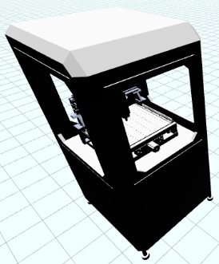
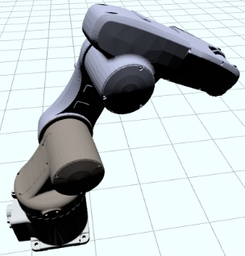
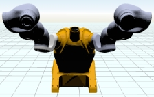
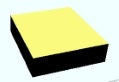
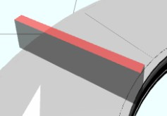
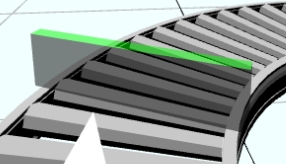
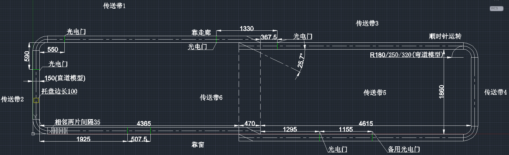
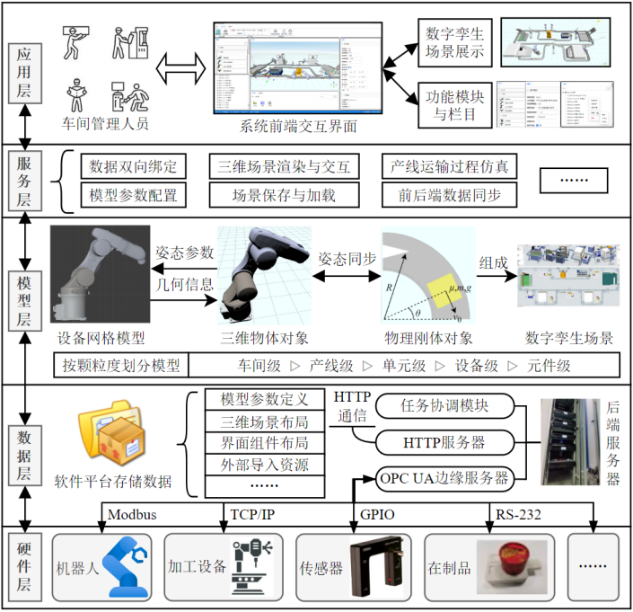
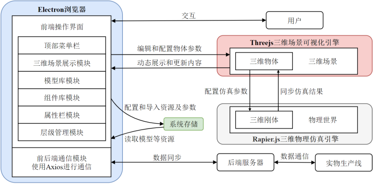

<div align="center">

[🇨🇳 中文](README.md) · [🇬🇧 English](README.en.md)

</div>

<div align="center">

# Digital Twin Software for Discrete Manufacturing Workshops

**A desktop digital-twin platform built on Vue 3 · Three.js · Rapier.js · Electron**

[](./LICENSE)
[](https://www.microsoft.com/windows)
[](https://vuejs.org)
[](https://threejs.org)
[](https://www.electronjs.org)

</div>

---

## 📌 Introduction

This project is a **digital-twin industrial software for discrete manufacturing workshops**. Targeting the "high-mix, low-volume" nature of discrete manufacturing, it provides an integrated pipeline of **digital-twin model construction, 3D scene visualization, physical process simulation, and two-way data communication / entity control with back-end and physical devices** — enabling virtual production-line layout validation, run-time simulation, and physical–virtual coupling.

> The following sections fully cover the design goals, key techniques, implementation and verification of the system.

## ✨ Features

- **3D scene management**: real-time rendering of the workshop (equipment, materials, personnel, …) with Three.js.
- **Physics simulation**: rigid bodies and physics via Rapier.js (`@dimforge/rapier3d`).
- **Model & component libraries**: built-in digital-twin objects such as CNC engravers, 6-/7-axis robots, conveyors, trays and sensors, classified by file type (`modelData.json` / `scene.json`).
- **Custom scene layout**: drag-and-drop (vue3-dnd) row/column containers to freely arrange virtual production lines.
- **View storage**: save and restore custom camera viewpoints of the 3D scene.
- **Custom scripts**: execute user scripts inside the scene to drive interaction logic.
- **Physical–virtual interaction**: two-way communication with the back-end via Axios for information sync and entity control between the physical asset and its twin.
- **Desktop delivery**: packaged as a standalone Windows desktop app with Electron.

## 🛠 Tech Stack

| Category | Technology |
| --- | --- |
| Front-end | Vue 3 + TypeScript |
| 3D rendering | Three.js (`three@0.158`) |
| Physics | Rapier.js (`@dimforge/rapier3d`) |
| Desktop | Electron 26 |
| Build | Vite 4 + vite-plugin-electron |
| Comms | Axios (bi-directional data) |
| UI | Ant Design Vue |
| Kinematics | kinematics-js |
| Packaging | electron-forge / electron-builder |

## 🖼 Interface & Model Library Preview

**Built-in digital-twin objects (sample models):**

<p align="center">
  
  
  
</p>
<p align="center">
  
  
  
</p>
<p align="center"><sub>Built-in digital-twin objects</sub></p>

<p align="center"></p>
<p align="center"><sub>Discrete-manufacturing conveyor-line layout with dimensions</sub></p>

<p align="center"></p>
<p align="center"><sub>Overall architecture of the digital-twin industrial software</sub></p>

<p align="center"></p>
<p align="center"><sub>Functional-module structure of the digital-twin software</sub></p>

## 📂 Project Structure

```
Digital_Twin_Software/
├─ electron/              # Electron main & preload scripts
│  ├─ main/index.ts        # Main process entry (window, ipcMain, security)
│  └─ preload/index.ts     # Preload script
├─ src/                   # Front-end source
│  ├─ assets/             # Resources: models / icons / svg / json / scenes
│  ├─ components/          # Vue 3 components (DTScene / Models / HttpService …)
│  ├─ config/             # Runtime config
│  └─ js/                 # DTObject.js / DTScene.js / global.js …
├─ docs/                  # Help docs, line dimensions, etc.
├─ public/                # Static assets (logo …)
├─ vite.config.ts         # Vite + Electron build config
└─ package.json           # Dependencies & scripts
```

## 🚀 Quick Start

> Requirements: Node.js + npm (Windows).

```sh
# 1. Install dependencies
npm install

# 2. Dev preview (start the Vite dev server)
npm run dev
#    or launch the desktop window directly via Electron Forge
npm run start

# 3. Build + package as a standalone desktop app
npm run build
node packager.js
#   output: out/DemoApp-win32-x64/DemoApp.exe

# 4. (Optional) build a Windows installer
npm run dist
```

Two batch scripts at the repo root mirror the above flow:

- `1.软件界面预览.bat` → `npm run dev`
- `2.软件编译、打包与启动.bat` → build, package and run the desktop app

## 🧩 Architecture & Modules

- **Main process (Electron)**: `electron/main` creates and manages the browser window, listens to load/move/resize events via `ipcMain`, and handles environment checks, script preloading and CORS policy at startup.
- **Front-end (Vue 3 + Three.js)**: `src/components` provide the UI feature modules; `src/js/DTScene.js` handles scene init, physics simulation and custom-script execution; `DTObject.js` defines digital-twin objects; `global.js` exposes shared globals across components (working around Electron's context isolation).
- **Data layer**: 3D objects, scenes, model & component libraries are represented, stored and parsed via `modelData.json` / `scene.json`; UI and custom-viewpoint data are likewise persisted.
- **Comms layer**: Axios provides two-way communication with the back-end, supporting information sync and entity control between the physical asset and its twin.

## 🧠 Design & Implementation

This section outlines the design goals, key techniques and implementation details, to help readers understand how the code is organized and how the system runs.

### Design Goals & Requirements

Targeting the high-mix, low-volume nature of discrete-manufacturing workshops (about 95% of machinery firms in China fall into this category), and addressing the shortcomings of conventional digital-twin software-rigid scenes, limited interaction/customization and no physics simulation-the system aims to be a twin platform that can import/manage custom models and scenes, support 3D physics simulation, and provide two-way data communication with the back-end and physical devices.

Functional requirements include: 3D scene and model-library management, drag-and-drop scene layout, viewpoint storage, custom scripts, physics simulation, and data communication / entity control with the back-end and physical devices. Data-interaction requirements demand real-time state and command synchronization among the software platform, back-end server and shop-floor devices.

### Model Construction & Rendering Optimization

Workshop equipment is categorized by shape and purpose into robots, machining equipment and packaging equipment, each modeled as a 3D mesh and added to the library. The system represents digital-twin objects with `DTObject`, keeping a mapping between their Mesh and RigidBody, and stores/parses them via `modelData.json` / `scene.json`.

Rendering uses the Three.js WebGL pipeline and the Phong lighting model. To reduce polygon counts without sacrificing appearance, the system applies hierarchical dynamic optimization: hiding faces of models that are relatively small or far away, and simplifying certain meshes with Marching-Cubes isosurface extraction, improving the rendering performance of large scenes.

### 3D Scene Interaction & Physics Simulation

The scene supports drag-and-drop layout: nested row/column containers with CSS flexbox let users freely arrange virtual production lines, with draggable splitters resizing modules. Mouse picking via ray casting determines whether a 3D object is hit, and box selection (intersection tests between the frustum and bounding boxes) enables multi-object operations.

Physics simulation is built on Rapier.js: rigid bodies and colliders are created for scene objects to simulate gravity, collisions and conveying, used to evaluate the rationality of a line layout.

### Physical-Virtual Communication Service

The data-communication system has three parts:

- **Protocol conversion module**: a bridge between the software platform and the back-end server, translating protocols and handling requests/data.
- **Task coordination module**: runs the Zeebe workflow engine to publish task requirements to device servers and schedule them.
- **OPC UA server**: distributed and close to the data source (edge side), directly reading or controlling the state of physical devices.

To support plug-and-produce under dynamically changing layouts, the system builds edge adapters for devices and trays using different protocols, enabling protocol insertion and data-format conversion; it also introduces AML-based OPC UA node configuration to synchronize the physical and virtual models. The front-end communicates bidirectionally with the back-end via Axios to sync states and control the physical asset.

### Data Storage Framework

The file structure is organized around `src` (UI components and runtime logic, models/icons and other resources), `docs` (help/report docs, line dimensions, node numbers and IPs, etc.) and `electron` (main process and preload scripts). 3D objects, scenes, model and component libraries are represented, stored and parsed as JSON; the UI layout and custom camera viewpoints of the 3D scene are persisted for later restoration.

### Front-end Interaction UI

The front-end is built on Vue 3 + JavaScript with native HTML and the Ant Design Vue component library. The UI is divided into a top menu bar, 3D scene view, model library, component library, property panel and hierarchy manager, arranged with nested row/column containers and flexbox, and adjustable by dragging. The system is packaged as a standalone Windows desktop app via Electron for easy transfer and running across machines and operating systems.

### Experiment Platform & Verification

The experiment platform consists of a front-end PC (Lenovo Blade 7000, Intel i7-7700, GTX 1060) and a lab smart production line (a private cloud of several Dell PowerEdge R240 and Inspur NF5270M3 servers, communicating with devices over OPC UA). After packaging the system as a desktop application, 3D scene construction, line-layout simulation and sync, data communication and device control are verified against the physical line, and the runtime performance of each module is tested and evaluated on both the PC and the physical line.

## 📄 License

`SCUT` (a South-China-University-of-Technology–related academic / course-design license). This repository is a course-design derivative; for licensing or commercial use, please contact the author.
