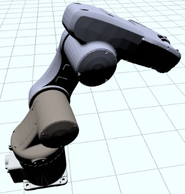
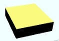
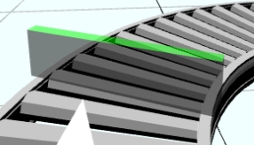
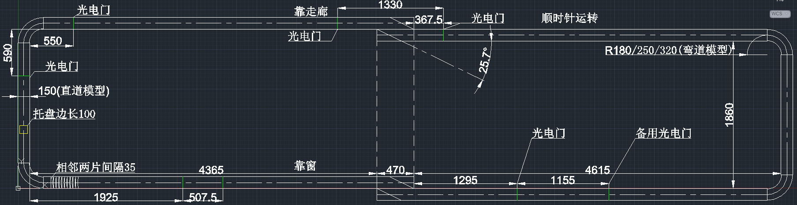
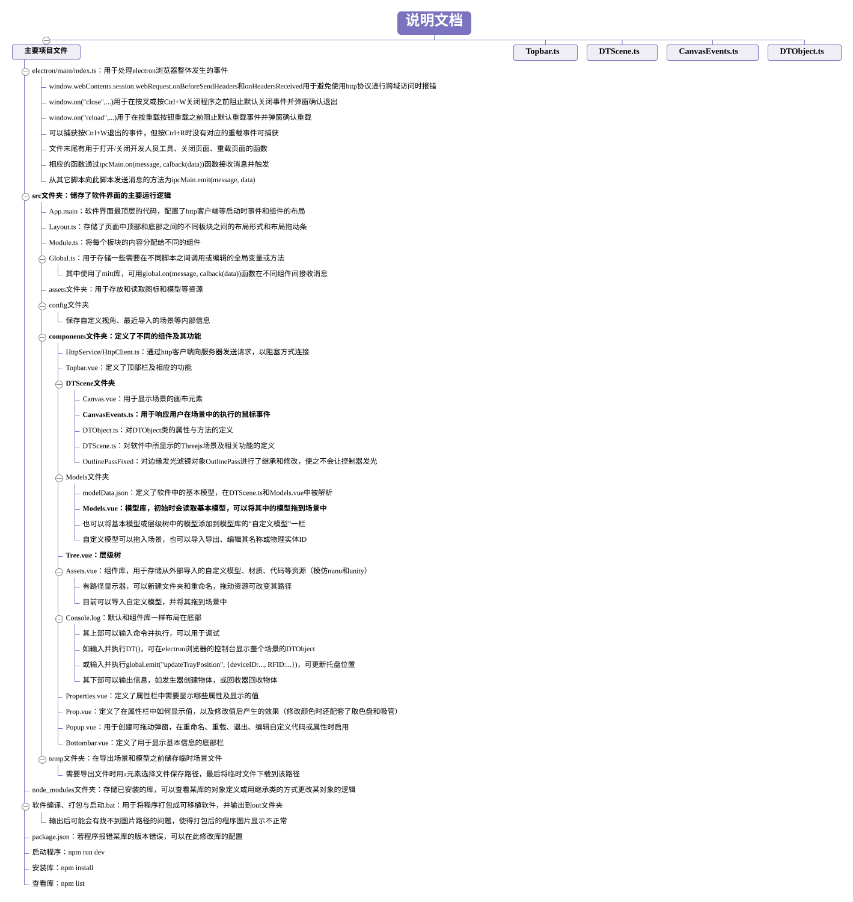

<!-- 双语切换：VS Code / 支持 HTML 的预览器中可点按切换；GitHub/GitCode 等会降级为双语并排显示 -->
<input type="radio" name="lang" id="tab-zh" checked>
<input type="radio" name="lang" id="tab-en">

<div align="center">

<label for="tab-zh">🇨🇳 中文</label>
&nbsp;&nbsp;|&nbsp;&nbsp;
<label for="tab-en">🇬🇧 English</label>

</div>

<style>
.lz, .le { display: none; }
#tab-zh:checked ~ .lz { display: block; }
#tab-en:checked ~ .le { display: block; }
input[name="lang"] { position: absolute; opacity: 0; pointer-events: none; }
</style>

<div align="center" class="lz">

# 离散制造车间数字孪生软件

**基于 Vue 3 · Three.js · Rapier.js · Electron 的桌面端数字孪生平台**

[](./LICENSE)
[](https://www.microsoft.com/windows)
[](https://vuejs.org)
[](https://threejs.org)
[](https://www.electronjs.org)

</div>

<div align="center" class="le">

# Digital Twin Software for Discrete Manufacturing Workshops

**A desktop digital-twin platform built on Vue 3 · Three.js · Rapier.js · Electron**

[](./LICENSE)
[](https://www.microsoft.com/windows)
[](https://vuejs.org)
[](https://threejs.org)
[](https://www.electronjs.org)

</div>

---

<div class="lz">

## 📌 项目简介

本项目是一款**面向离散制造车间的数字孪生工业软件**。它围绕离散制造"多品种、小批量"的生产特点，提供从**数字孪生模型构建、三维场景可视化、生产过程物理仿真，到与后端 / 实物设备双向数据通信与实体控制**的一体化能力，帮助车间在虚拟环境中完成产线布局验证、运行仿真与虚实联动。

> 下文完整介绍系统的设计目标、关键技术与实现验证过程。

## ✨ 功能特性

- **三维场景管理**：基于 Three.js 实时渲染离散制造车间，涵盖设备、物料、人员等要素。
- **物理仿真**：集成 Rapier.js（`@dimforge/rapier3d`），为场景物体构建刚体并运行物理仿真。
- **模型库与组件库**：内置 CNC 精雕机、六轴/七轴机器人、传送道、托盘、传感器等数字孪生对象，按文件类型分类管理（`modelData.json` / `scene.json`）。
- **自定义场景布局**：借助拖拽式布局（vue3-dnd）以行/列容器自由编排虚拟产线。
- **视角存储**：保存与恢复三维场景的自定义观察视角。
- **自定义脚本**：在场景中执行用户脚本，驱动交互逻辑。
- **虚实交互**：通过 Axios 与后端服务器双向通信，实现实物与其数字孪生体之间的信息同步与实体控制。
- **桌面化交付**：基于 Electron 打包为独立的 Windows 桌面应用。

## 🛠 技术栈

| 类别 | 技术 |
| --- | --- |
| 前端框架 | Vue 3 + TypeScript |
| 3D 渲染 | Three.js (`three@0.158`) |
| 物理引擎 | Rapier.js (`@dimforge/rapier3d`) |
| 桌面框架 | Electron 26 |
| 构建工具 | Vite 4 + vite-plugin-electron |
| 通信 | Axios（前后端双向数据） |
| UI 组件 | Ant Design Vue |
| 机器人运动学 | kinematics-js |
| 打包 | electron-forge / electron-builder |

## 🖼 界面与模型库预览

**数字孪生对象库（部分内置模型）：**

<div align="center">

| | | |
| --- | --- | --- |
|  |  |  |
|  |  |  |

*内置数字孪生对象 / Built-in digital-twin objects*

</div>

<div align="center">



*离散制造产线输送线布局图（含尺寸标注）/ Production-line conveyor layout with dimensions*

</div>

<div align="center">



*系统说明文档图 / System documentation diagram*

</div>

## 📂 项目结构

```
Digital_Twin_Software/
├─ electron/              # Electron 主进程与预加载脚本
│  ├─ main/index.ts        # 主进程入口（窗口、ipcMain、安全策略）
│  └─ preload/index.ts     # 预加载脚本
├─ src/                   # 前端主体
│  ├─ assets/             # 资源：models / icons / svg / json / 场景文件
│  ├─ components/          # Vue 3 组件（DTScene / Models / HttpService …）
│  ├─ config/             # 运行配置
│  └─ js/                 # DTObject.js / DTScene.js / global.js …
├─ docs/                  # 帮助与说明文档、产线尺寸等数据
├─ public/                # 静态资源（logo 等）
├─ vite.config.ts         # Vite + Electron 构建配置
└─ package.json           # 依赖与脚本
```

## 🚀 快速开始

> 环境要求：Node.js + npm（Windows）。

```sh
# 1. 安装依赖
npm install

# 2. 开发预览（启动 Vite 开发服务器）
npm run dev
#    或通过 Electron Forge 直接启动桌面窗口
npm run start

# 3. 编译 + 打包为独立桌面程序
npm run build
node packager.js
#   产物位于 out/DemoApp-win32-x64/DemoApp.exe

# 4.（可选）生成 Windows 安装包
npm run dist
```

仓库根目录附带两个批处理脚本，对应上述流程：

- `1.软件界面预览.bat` → `npm run dev`
- `2.软件编译、打包与启动.bat` → 编译、打包并直接运行桌面程序

## 🧩 架构与模块

- **主进程（Electron）**：`electron/main` 负责创建并管理浏览器窗口，通过 `ipcMain` 监听窗口加载、移动、缩放等事件，并在初始化时校验环境、预加载脚本、配置跨域策略。
- **前端（Vue 3 + Three.js）**：`src/components` 提供界面各功能模块组件；`src/js/DTScene.js` 负责三维场景初始化、物理仿真与自定义脚本执行；`DTObject.js` 定义数字孪生对象；`global.js` 提供跨组件共享的全局变量（规避 Electron 上下文隔离限制）。
- **数据层**：三维物体、场景、模型库与组件库分别由 `modelData.json` / `scene.json` 表示、存储与解析；交互界面与自定义视角数据 likewise 持久化。
- **通信层**：通过 Axios 与后端服务器双向通信，支撑实物–孪生体的信息同步与实体控制。

## 🧠 设计与实现

本节概述系统的设计目标、关键技术与实现要点，便于理解代码组织与运行机制。

### 设计目标与需求

系统面向离散制造车间「多品种、小批量」的生产特点（我国约 95% 的机械制造企业属此类型），针对传统数字孪生软件场景固定、交互效率与自定义能力不足、缺少物理仿真等问题，目标是构建一个可导入 / 管理自定义模型与场景、支持三维物理仿真与前后端双向通信的数字孪生平台，以提升产线布局验证与运行仿真的灵活性和实用性。

功能需求可归纳为：三维场景与模型库管理、场景拖拽布局、视角存储、自定义脚本、物理仿真，以及与后端 / 实物设备的数据通信与实体控制；数据交互需求则要求软件平台、后端服务器与车间设备之间能够实时同步状态与指令。

### 模型构建与渲染优化

离散制造车间的设备按外形与用途分为机器人、加工设备、包装设备等类别，分别构建三维网格模型并入库。系统以 `DTObject` 表示数字孪生对象，维护其网格（Mesh）与刚体（RigidBody）的映射关系，并通过 `modelData.json` / `scene.json` 存储与解析。

渲染基于 Three.js 的 WebGL 渲染管线与 Phong 光照模型。为了在保证外观的前提下降低面片数量，系统采用分层动态优化：对相对尺寸较小或距离较远的模型按比例隐藏面片，并对部分模型使用 Marching Cubes 等值面提取简化网格结构，从而提升大规模场景的渲染性能。

### 三维场景交互与物理仿真

场景支持拖拽式布局：通过行容器与列容器的嵌套，结合 CSS 弹性盒子（flex）布局，自由编排虚拟产线；模块之间以可拖拽的分隔组件调整尺寸。系统通过射线拾取判断鼠标是否命中三维物体，并支持基于视锥体与包围盒相交判断的框选，对多个物体进行操作。

物理仿真基于 Rapier.js：为场景物体构建刚体与碰撞体，模拟重力、碰撞与传送等物理规律，用于评估产线布局的合理性。

### 虚实通信服务

数据通信系统分为三部分：

- **协议转换模块**：作为软件平台与后端服务器之间的通信桥梁，转换不同通信协议并处理请求与数据。
- **任务协调模块**：部署 Zeebe 工作流引擎，负责向设备服务器发布任务需求并进行调度。
- **OPC UA 服务器**：分布式部署、贴近数据源（边缘端），可直接获取或控制物理设备的运行状态。

为支持车间布局动态变化下的「即插即生产」，系统为采用不同通信协议的设备与产品托盘开发边缘适配器，实现协议插入与数据格式转换；并引入基于 AML 格式的 OPC UA 数据节点配置与通信方式，实现虚实模型之间的信息同步。前端通过 Axios 与后端进行双向通信，完成实物与孪生体的状态同步与实体控制。

### 数据存储框架

系统文件结构围绕 `src`（界面组件与运行逻辑、模型 / 图标等资源）、`docs`（说明与汇报文档、产线尺寸、节点编号与 IP 等）、`electron`（主进程与预加载脚本）组织。三维物体、场景、模型库与组件库分别以 JSON 表示、存储与解析；交互界面布局与三维场景的自定义视角亦持久化保存，供后续恢复。

### 前端交互界面

前端基于 Vue 3 + JavaScript，结合 HTML 原生组件与 Ant Design 组件库构建。界面划分为顶部菜单栏、三维场景展示、模型库、组件库、属性栏、层级管理等模块，各模块通过行 / 列容器嵌套与弹性布局排布，并支持拖拽调整。系统通过 Electron 打包为可独立运行的 Windows 桌面应用，便于在不同计算机或操作系统之间传输与运行。

### 实验平台与功能验证

实验平台由前端计算机（联想刃 7000，Intel i7-7700，GTX 1060）与实验室智能生产线（多台戴尔 PowerEdge R240 与浪潮 NF5270M3 组成的私有云集群，通过 OPC UA 与设备通信）构成。系统打包为桌面程序后，以实物生产线为参照，对三维场景构建、产线布局仿真与同步、数据通信与设备控制等功能进行验证，并结合计算机与实体产线对各模块的运行性能进行测试与评估。

## 📄 许可证

`SCUT`（与华南理工大学相关的课程设计 / 学术用途授权）。本仓库为课程设计衍生作品，具体授权与商用事宜请联系作者。

</div>

<div class="le">

## 📌 Introduction

This project is a **digital-twin industrial software for discrete manufacturing workshops**. Targeting the "high-mix, low-volume" nature of discrete manufacturing, it provides an integrated pipeline of **digital-twin model construction, 3D scene visualization, physical process simulation, and two-way data communication / entity control with back-end and physical devices** — enabling virtual production-line layout validation, run-time simulation, and physical–virtual coupling.

> The following sections fully cover the design goals, key techniques, implementation and verification of the system.

## ✨ Features

- **3D scene management**: real-time rendering of the workshop (equipment, materials, personnel, …) with Three.js.
- **Physics simulation**: rigid bodies and physics via Rapier.js (`@dimforge/rapier3d`).
- **Model & component libraries**: built-in digital-twin objects such as CNC engravers, 6-/7-axis robots, conveyors, trays and sensors, classified by file type (`modelData.json` / `scene.json`).
- **Custom scene layout**: drag-and-drop (vue3-dnd) row/column containers to freely arrange virtual production lines.
- **View storage**: save and restore custom camera viewpoints of the 3D scene.
- **Custom scripts**: execute user scripts inside the scene to drive interaction logic.
- **Physical–virtual interaction**: two-way communication with the back-end via Axios for information sync and entity control between the physical asset and its twin.
- **Desktop delivery**: packaged as a standalone Windows desktop app with Electron.

## 🛠 Tech Stack

| Category | Technology |
| --- | --- |
| Front-end | Vue 3 + TypeScript |
| 3D rendering | Three.js (`three@0.158`) |
| Physics | Rapier.js (`@dimforge/rapier3d`) |
| Desktop | Electron 26 |
| Build | Vite 4 + vite-plugin-electron |
| Comms | Axios (bi-directional data) |
| UI | Ant Design Vue |
| Kinematics | kinematics-js |
| Packaging | electron-forge / electron-builder |

## 🖼 Interface & Model Library Preview

**Built-in digital-twin objects (sample models):**

<div align="center">

| | | |
| --- | --- | --- |
|  |  |  |
|  |  |  |

*Built-in digital-twin objects*

</div>

<div align="center">


*Discrete-manufacturing conveyor-line layout with dimensions*

</div>

<div align="center">


*System documentation diagram*

</div>

## 📂 Project Structure

```
Digital_Twin_Software/
├─ electron/              # Electron main & preload scripts
│  ├─ main/index.ts        # Main process entry (window, ipcMain, security)
│  └─ preload/index.ts     # Preload script
├─ src/                   # Front-end source
│  ├─ assets/             # Resources: models / icons / svg / json / scenes
│  ├─ components/          # Vue 3 components (DTScene / Models / HttpService …)
│  ├─ config/             # Runtime config
│  └─ js/                 # DTObject.js / DTScene.js / global.js …
├─ docs/                  # Help docs, line dimensions, etc.
├─ public/                # Static assets (logo …)
├─ vite.config.ts         # Vite + Electron build config
└─ package.json           # Dependencies & scripts
```

## 🚀 Quick Start

> Requirements: Node.js + npm (Windows).

```sh
# 1. Install dependencies
npm install

# 2. Dev preview (start the Vite dev server)
npm run dev
#    or launch the desktop window directly via Electron Forge
npm run start

# 3. Build + package as a standalone desktop app
npm run build
node packager.js
#   output: out/DemoApp-win32-x64/DemoApp.exe

# 4. (Optional) build a Windows installer
npm run dist
```

Two batch scripts at the repo root mirror the above flow:

- `1.软件界面预览.bat` → `npm run dev`
- `2.软件编译、打包与启动.bat` → build, package and run the desktop app

## 🧩 Architecture & Modules

- **Main process (Electron)**: `electron/main` creates and manages the browser window, listens to load/move/resize events via `ipcMain`, and handles environment checks, script preloading and CORS policy at startup.
- **Front-end (Vue 3 + Three.js)**: `src/components` provide the UI feature modules; `src/js/DTScene.js` handles scene init, physics simulation and custom-script execution; `DTObject.js` defines digital-twin objects; `global.js` exposes shared globals across components (working around Electron's context isolation).
- **Data layer**: 3D objects, scenes, model & component libraries are represented, stored and parsed via `modelData.json` / `scene.json`; UI and custom-viewpoint data are likewise persisted.
- **Comms layer**: Axios provides two-way communication with the back-end, supporting information sync and entity control between the physical asset and its twin.

## 🧠 Design & Implementation

This section outlines the design goals, key techniques and implementation details, to help readers understand how the code is organized and how the system runs.

### Design Goals & Requirements

Targeting the high-mix, low-volume nature of discrete-manufacturing workshops (about 95% of machinery firms in China fall into this category), and addressing the shortcomings of conventional digital-twin software-rigid scenes, limited interaction/customization and no physics simulation-the system aims to be a twin platform that can import/manage custom models and scenes, support 3D physics simulation, and provide two-way data communication with the back-end and physical devices.

Functional requirements include: 3D scene and model-library management, drag-and-drop scene layout, viewpoint storage, custom scripts, physics simulation, and data communication / entity control with the back-end and physical devices. Data-interaction requirements demand real-time state and command synchronization among the software platform, back-end server and shop-floor devices.

### Model Construction & Rendering Optimization

Workshop equipment is categorized by shape and purpose into robots, machining equipment and packaging equipment, each modeled as a 3D mesh and added to the library. The system represents digital-twin objects with `DTObject`, keeping a mapping between their Mesh and RigidBody, and stores/parses them via `modelData.json` / `scene.json`.

Rendering uses the Three.js WebGL pipeline and the Phong lighting model. To reduce polygon counts without sacrificing appearance, the system applies hierarchical dynamic optimization: hiding faces of models that are relatively small or far away, and simplifying certain meshes with Marching-Cubes isosurface extraction, improving the rendering performance of large scenes.

### 3D Scene Interaction & Physics Simulation

The scene supports drag-and-drop layout: nested row/column containers with CSS flexbox let users freely arrange virtual production lines, with draggable splitters resizing modules. Mouse picking via ray casting determines whether a 3D object is hit, and box selection (intersection tests between the frustum and bounding boxes) enables multi-object operations.

Physics simulation is built on Rapier.js: rigid bodies and colliders are created for scene objects to simulate gravity, collisions and conveying, used to evaluate the rationality of a line layout.

### Physical-Virtual Communication Service

The data-communication system has three parts:

- **Protocol conversion module**: a bridge between the software platform and the back-end server, translating protocols and handling requests/data.
- **Task coordination module**: runs the Zeebe workflow engine to publish task requirements to device servers and schedule them.
- **OPC UA server**: distributed and close to the data source (edge side), directly reading or controlling the state of physical devices.

To support plug-and-produce under dynamically changing layouts, the system builds edge adapters for devices and trays using different protocols, enabling protocol insertion and data-format conversion; it also introduces AML-based OPC UA node configuration to synchronize the physical and virtual models. The front-end communicates bidirectionally with the back-end via Axios to sync states and control the physical asset.

### Data Storage Framework

The file structure is organized around `src` (UI components and runtime logic, models/icons and other resources), `docs` (help/report docs, line dimensions, node numbers and IPs, etc.) and `electron` (main process and preload scripts). 3D objects, scenes, model and component libraries are represented, stored and parsed as JSON; the UI layout and custom camera viewpoints of the 3D scene are persisted for later restoration.

### Front-end Interaction UI

The front-end is built on Vue 3 + JavaScript with native HTML and the Ant Design Vue component library. The UI is divided into a top menu bar, 3D scene view, model library, component library, property panel and hierarchy manager, arranged with nested row/column containers and flexbox, and adjustable by dragging. The system is packaged as a standalone Windows desktop app via Electron for easy transfer and running across machines and operating systems.

### Experiment Platform & Verification

The experiment platform consists of a front-end PC (Lenovo Blade 7000, Intel i7-7700, GTX 1060) and a lab smart production line (a private cloud of several Dell PowerEdge R240 and Inspur NF5270M3 servers, communicating with devices over OPC UA). After packaging the system as a desktop application, 3D scene construction, line-layout simulation and sync, data communication and device control are verified against the physical line, and the runtime performance of each module is tested and evaluated on both the PC and the physical line.

## 📄 License

`SCUT` (a South-China-University-of-Technology–related academic / course-design license). This repository is a course-design derivative; for licensing or commercial use, please contact the author.

</div>
