<!-- 双语切换：VS Code / 支持 HTML 的预览器中可点按切换；GitHub/GitCode 等会降级为双语并排显示 -->
<input type="radio" name="lang" id="tab-zh" checked>
<input type="radio" name="lang" id="tab-en">

<div align="center">

<label for="tab-zh">🇨🇳 中文</label>
&nbsp;&nbsp;|&nbsp;&nbsp;
<label for="tab-en">🇬🇧 English</label>

</div>

<style>
.lz, .le { display: none; }
#tab-zh:checked ~ .lz { display: block; }
#tab-en:checked ~ .le { display: block; }
input[name="lang"] { position: absolute; opacity: 0; pointer-events: none; }
</style>

<div align="center" class="lz">

# 离散制造车间数字孪生软件

**基于 Vue 3 · Three.js · Rapier.js · Electron 的桌面端数字孪生平台**

[](./LICENSE)
[](https://www.microsoft.com/windows)
[](https://vuejs.org)
[](https://threejs.org)
[](https://www.electronjs.org)

</div>

<div align="center" class="le">

# Digital Twin Software for Discrete Manufacturing Workshops

**A desktop digital-twin platform built on Vue 3 · Three.js · Rapier.js · Electron**

[](./LICENSE)
[](https://www.microsoft.com/windows)
[](https://vuejs.org)
[](https://threejs.org)
[](https://www.electronjs.org)

</div>

---

<div class="lz">

## 📌 项目简介

本项目是一款**面向离散制造车间的数字孪生工业软件**。它围绕离散制造"多品种、小批量"的生产特点，提供从**数字孪生模型构建、三维场景可视化、生产过程物理仿真，到与后端 / 实物设备双向数据通信与实体控制**的一体化能力，帮助车间在虚拟环境中完成产线布局验证、运行仿真与虚实联动。

> 设计文档与原理详见作者在 B 站「科技」文集的系列专栏（见文末[延伸阅读](#延伸阅读)）。

## ✨ 功能特性

- **三维场景管理**：基于 Three.js 实时渲染离散制造车间，涵盖设备、物料、人员等要素。
- **物理仿真**：集成 Rapier.js（`@dimforge/rapier3d`），为场景物体构建刚体并运行物理仿真。
- **模型库与组件库**：内置 CNC 精雕机、六轴/七轴机器人、传送道、托盘、传感器等数字孪生对象，按文件类型分类管理（`modelData.json` / `scene.json`）。
- **自定义场景布局**：借助拖拽式布局（vue3-dnd）以行/列容器自由编排虚拟产线。
- **视角存储**：保存与恢复三维场景的自定义观察视角。
- **自定义脚本**：在场景中执行用户脚本，驱动交互逻辑。
- **虚实交互**：通过 Axios 与后端服务器双向通信，实现实物与其数字孪生体之间的信息同步与实体控制。
- **桌面化交付**：基于 Electron 打包为独立的 Windows 桌面应用。

## 🛠 技术栈

| 类别 | 技术 |
| --- | --- |
| 前端框架 | Vue 3 + TypeScript |
| 3D 渲染 | Three.js (`three@0.158`) |
| 物理引擎 | Rapier.js (`@dimforge/rapier3d`) |
| 桌面框架 | Electron 26 |
| 构建工具 | Vite 4 + vite-plugin-electron |
| 通信 | Axios（前后端双向数据） |
| UI 组件 | Ant Design Vue |
| 机器人运动学 | kinematics-js |
| 打包 | electron-forge / electron-builder |

## 🖼 界面与模型库预览

**数字孪生对象库（部分内置模型）：**

<div align="center">

| | | |
| --- | --- | --- |
| 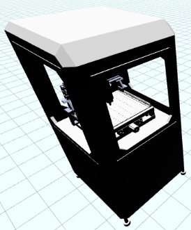 |  | 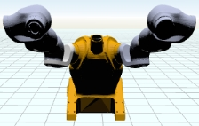 |
|  |  |  |

*内置数字孪生对象 / Built-in digital-twin objects*

</div>

<div align="center">


*离散制造产线输送线布局图（含尺寸标注）/ Production-line conveyor layout with dimensions*

</div>

<div align="center">


*系统说明文档图 / System documentation diagram*

</div>

## 📂 项目结构

```
Digital_Twin_Software/
├─ electron/              # Electron 主进程与预加载脚本
│  ├─ main/index.ts        # 主进程入口（窗口、ipcMain、安全策略）
│  └─ preload/index.ts     # 预加载脚本
├─ src/                   # 前端主体
│  ├─ assets/             # 资源：models / icons / svg / json / 场景文件
│  ├─ components/          # Vue 3 组件（DTScene / Models / HttpService …）
│  ├─ config/             # 运行配置
│  └─ js/                 # DTObject.js / DTScene.js / global.js …
├─ docs/                  # 帮助与说明文档、产线尺寸等数据
├─ public/                # 静态资源（logo 等）
├─ vite.config.ts         # Vite + Electron 构建配置
└─ package.json           # 依赖与脚本
```

## 🚀 快速开始

> 环境要求：Node.js + npm（Windows）。

```sh
# 1. 安装依赖
npm install

# 2. 开发预览（启动 Vite 开发服务器）
npm run dev
#    或通过 Electron Forge 直接启动桌面窗口
npm run start

# 3. 编译 + 打包为独立桌面程序
npm run build
node packager.js
#   产物位于 out/DemoApp-win32-x64/DemoApp.exe

# 4.（可选）生成 Windows 安装包
npm run dist
```

仓库根目录附带两个批处理脚本，对应上述流程：

- `1.软件界面预览.bat` → `npm run dev`
- `2.软件编译、打包与启动.bat` → 编译、打包并直接运行桌面程序

## 🧩 架构与模块

- **主进程（Electron）**：`electron/main` 负责创建并管理浏览器窗口，通过 `ipcMain` 监听窗口加载、移动、缩放等事件，并在初始化时校验环境、预加载脚本、配置跨域策略。
- **前端（Vue 3 + Three.js）**：`src/components` 提供界面各功能模块组件；`src/js/DTScene.js` 负责三维场景初始化、物理仿真与自定义脚本执行；`DTObject.js` 定义数字孪生对象；`global.js` 提供跨组件共享的全局变量（规避 Electron 上下文隔离限制）。
- **数据层**：三维物体、场景、模型库与组件库分别由 `modelData.json` / `scene.json` 表示、存储与解析；交互界面与自定义视角数据 likewise 持久化。
- **通信层**：通过 Axios 与后端服务器双向通信，支撑实物–孪生体的信息同步与实体控制。

## 📚 延伸阅读

作者在 B 站「科技」文集撰写了与本软件对应的系列专栏（理论 + 设计），可作为深入文档。以下按主题分组，并精选部分专栏封面：

<div align="center">

[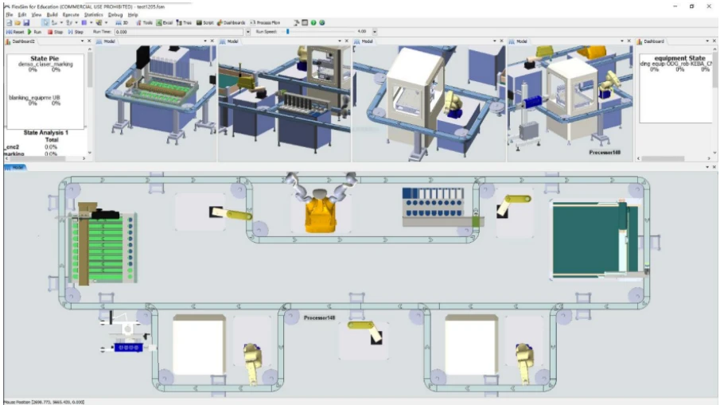](https://www.bilibili.com/read/cv45061740)
[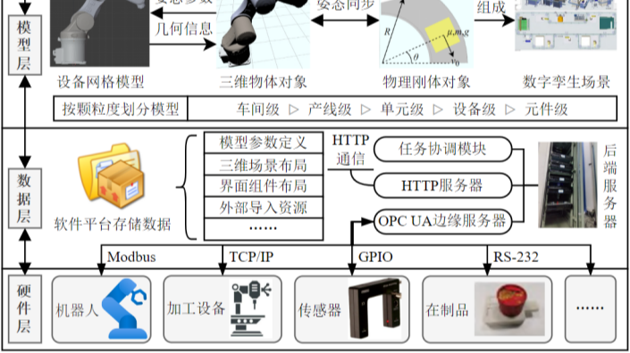](https://www.bilibili.com/read/cv45286314)
[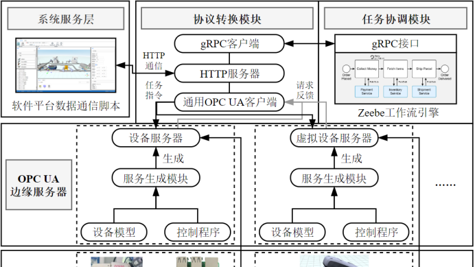](https://www.bilibili.com/read/cv45286887)
[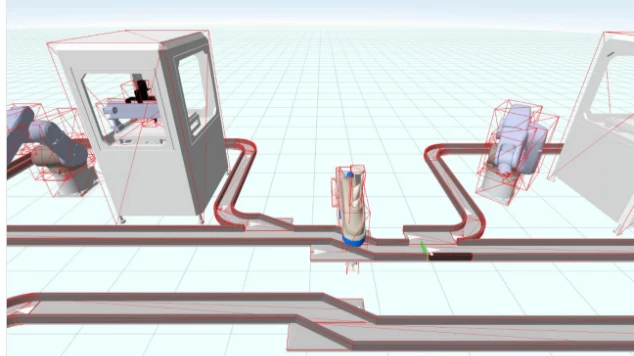](https://www.bilibili.com/read/cv45061763)
[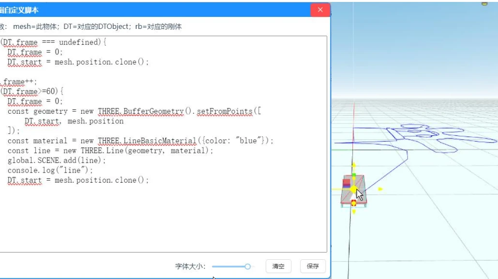](https://www.bilibili.com/read/cv45061771)
[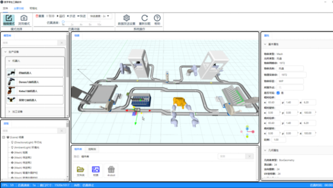](https://www.bilibili.com/read/cv45284376)
[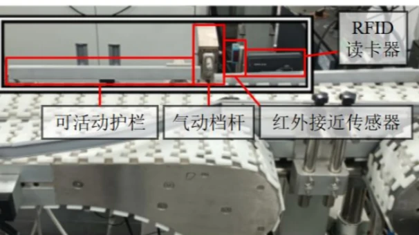](https://www.bilibili.com/read/cv45090723)
[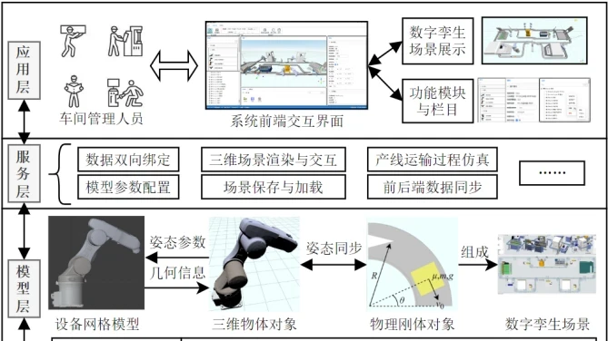](https://www.bilibili.com/read/cv44922912)
[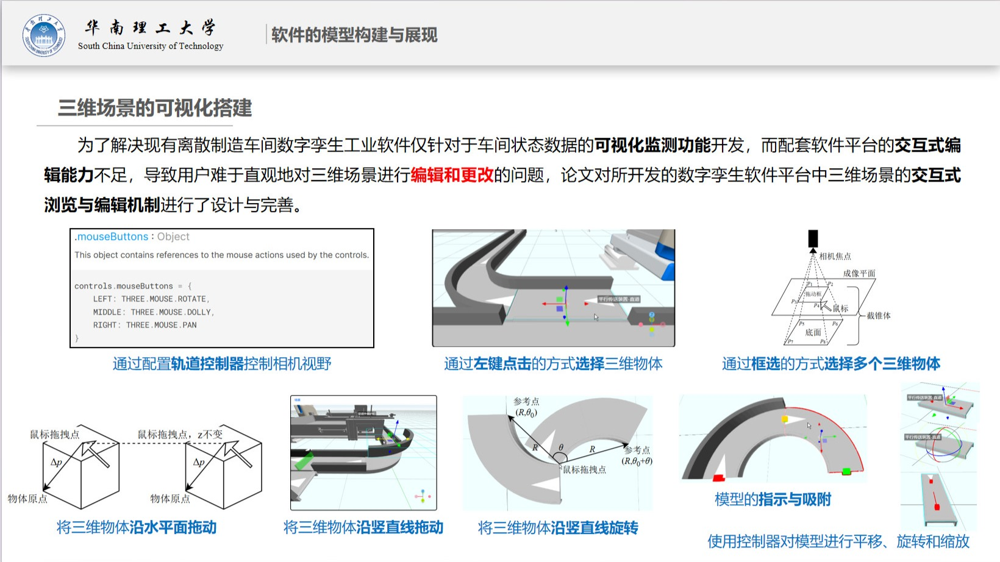](https://www.bilibili.com/read/cv45193573)
[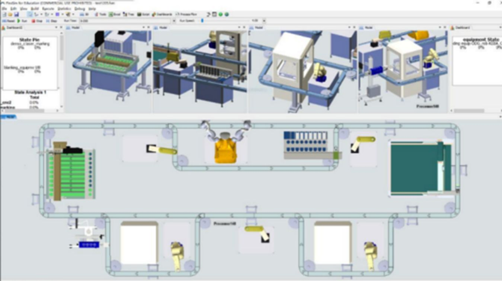](https://www.bilibili.com/read/cv44340160)

</div>

### 开篇与综述
- [《面向离散制造的数字孪生三维场景管理与仿真系统绪论》](https://www.bilibili.com/read/cv45061740)
- [《离散制造车间数字孪生工业软件国内外研究现状》](https://www.bilibili.com/read/cv45285990)
- [《数字孪生工业软件：论文插图》](https://www.bilibili.com/read/cv44922912)

### 需求分析与架构设计
- [《数字孪生工业软件需求分析与架构设计》](https://www.bilibili.com/read/cv45061756)
- [《离散制造车间数字孪生软件需求分析与架构设计》](https://www.bilibili.com/read/cv45286314)

### 模型构建与三维场景
- [《离散制造车间数字孪生软件的模型构建与展现》](https://www.bilibili.com/read/cv45288771)
- [《一种面向离散制造的数字孪生三维场景管理与仿真方法》](https://www.bilibili.com/read/cv45321425)

### 虚实通信与数据存储
- [《离散制造车间数字孪生软件的虚实通信服务实现》](https://www.bilibili.com/read/cv45286887)
- [《数字孪生系统数据存储框架设计与仿真功能实现》](https://www.bilibili.com/read/cv45061763)

### 前端交互界面
- [《数字孪生系统前端交互界面设计与实现》](https://www.bilibili.com/read/cv45061771)

### 实现、验证与实验平台
- [《离散制造车间数字孪生工业软件实现与验证》](https://www.bilibili.com/read/cv45284376)
- [《数字孪生实验平台搭建与功能评估》](https://www.bilibili.com/read/cv45090723)

### 学位论文相关
- [《工业机器人数字孪生工具软件的设计与实现》](https://www.bilibili.com/read/cv44340160)
- [《数字孪生工业软件：分委会意见回复与学位论文答辩PPT》](https://www.bilibili.com/read/cv45193573)

## 📄 许可证

`SCUT`（与华南理工大学相关的课程设计 / 学术用途授权）。本仓库为课程设计衍生作品，具体授权与商用事宜请联系作者。

</div>

<div class="le">

## 📌 Introduction

This project is a **digital-twin industrial software for discrete manufacturing workshops**. Targeting the "high-mix, low-volume" nature of discrete manufacturing, it provides an integrated pipeline of **digital-twin model construction, 3D scene visualization, physical process simulation, and two-way data communication / entity control with back-end and physical devices** — enabling virtual production-line layout validation, run-time simulation, and physical–virtual coupling.

> Design docs and underlying principles are covered in the author's Bilibili "Tech" column series (see [Further Reading](#further-reading) at the end).

## ✨ Features

- **3D scene management**: real-time rendering of the workshop (equipment, materials, personnel, …) with Three.js.
- **Physics simulation**: rigid bodies and physics via Rapier.js (`@dimforge/rapier3d`).
- **Model & component libraries**: built-in digital-twin objects such as CNC engravers, 6-/7-axis robots, conveyors, trays and sensors, classified by file type (`modelData.json` / `scene.json`).
- **Custom scene layout**: drag-and-drop (vue3-dnd) row/column containers to freely arrange virtual production lines.
- **View storage**: save and restore custom camera viewpoints of the 3D scene.
- **Custom scripts**: execute user scripts inside the scene to drive interaction logic.
- **Physical–virtual interaction**: two-way communication with the back-end via Axios for information sync and entity control between the physical asset and its twin.
- **Desktop delivery**: packaged as a standalone Windows desktop app with Electron.

## 🛠 Tech Stack

| Category | Technology |
| --- | --- |
| Front-end | Vue 3 + TypeScript |
| 3D rendering | Three.js (`three@0.158`) |
| Physics | Rapier.js (`@dimforge/rapier3d`) |
| Desktop | Electron 26 |
| Build | Vite 4 + vite-plugin-electron |
| Comms | Axios (bi-directional data) |
| UI | Ant Design Vue |
| Kinematics | kinematics-js |
| Packaging | electron-forge / electron-builder |

## 🖼 Interface & Model Library Preview

**Built-in digital-twin objects (sample models):**

<div align="center">

| | | |
| --- | --- | --- |
|  |  |  |
|  |  |  |

*Built-in digital-twin objects*

</div>

<div align="center">


*Discrete-manufacturing conveyor-line layout with dimensions*

</div>

<div align="center">


*System documentation diagram*

</div>

## 📂 Project Structure

```
Digital_Twin_Software/
├─ electron/              # Electron main & preload scripts
│  ├─ main/index.ts        # Main process entry (window, ipcMain, security)
│  └─ preload/index.ts     # Preload script
├─ src/                   # Front-end source
│  ├─ assets/             # Resources: models / icons / svg / json / scenes
│  ├─ components/          # Vue 3 components (DTScene / Models / HttpService …)
│  ├─ config/             # Runtime config
│  └─ js/                 # DTObject.js / DTScene.js / global.js …
├─ docs/                  # Help docs, line dimensions, etc.
├─ public/                # Static assets (logo …)
├─ vite.config.ts         # Vite + Electron build config
└─ package.json           # Dependencies & scripts
```

## 🚀 Quick Start

> Requirements: Node.js + npm (Windows).

```sh
# 1. Install dependencies
npm install

# 2. Dev preview (start the Vite dev server)
npm run dev
#    or launch the desktop window directly via Electron Forge
npm run start

# 3. Build + package as a standalone desktop app
npm run build
node packager.js
#   output: out/DemoApp-win32-x64/DemoApp.exe

# 4. (Optional) build a Windows installer
npm run dist
```

Two batch scripts at the repo root mirror the above flow:

- `1.软件界面预览.bat` → `npm run dev`
- `2.软件编译、打包与启动.bat` → build, package and run the desktop app

## 🧩 Architecture & Modules

- **Main process (Electron)**: `electron/main` creates and manages the browser window, listens to load/move/resize events via `ipcMain`, and handles environment checks, script preloading and CORS policy at startup.
- **Front-end (Vue 3 + Three.js)**: `src/components` provide the UI feature modules; `src/js/DTScene.js` handles scene init, physics simulation and custom-script execution; `DTObject.js` defines digital-twin objects; `global.js` exposes shared globals across components (working around Electron's context isolation).
- **Data layer**: 3D objects, scenes, model & component libraries are represented, stored and parsed via `modelData.json` / `scene.json`; UI and custom-viewpoint data are likewise persisted.
- **Comms layer**: Axios provides two-way communication with the back-end, supporting information sync and entity control between the physical asset and its twin.

## 📚 Further Reading

The author's Bilibili "Tech" column series corresponds to this software (theory + design) and serves as in-depth documentation. Grouped by topic below, with selected cover images:

<div align="center">

[](https://www.bilibili.com/read/cv45061740)
[](https://www.bilibili.com/read/cv45286314)
[](https://www.bilibili.com/read/cv45286887)
[](https://www.bilibili.com/read/cv45061763)
[](https://www.bilibili.com/read/cv45061771)
[](https://www.bilibili.com/read/cv45284376)
[](https://www.bilibili.com/read/cv45090723)
[](https://www.bilibili.com/read/cv44922912)
[](https://www.bilibili.com/read/cv45193573)
[](https://www.bilibili.com/read/cv44340160)

</div>

### Overview & Introduction
- [Introduction to a Discrete-Manufacturing-Oriented Digital-Twin 3D Scene Management & Simulation System](https://www.bilibili.com/read/cv45061740)
- [Research Status of Discrete-Manufacturing-Workshop Digital-Twin Industrial Software (Domestic & Abroad)](https://www.bilibili.com/read/cv45285990)
- [Digital-Twin Industrial Software: Thesis Figures](https://www.bilibili.com/read/cv44922912)

### Requirement Analysis & Architecture
- [Requirement Analysis & Architecture Design of Digital-Twin Industrial Software](https://www.bilibili.com/read/cv45061756)
- [Requirement Analysis & Architecture Design of Discrete-Manufacturing-Workshop Digital-Twin Software](https://www.bilibili.com/read/cv45286314)

### Model Construction & 3D Scenes
- [Model Construction & Rendering of Discrete-Manufacturing-Workshop Digital-Twin Software](https://www.bilibili.com/read/cv45288771)
- [A Discrete-Manufacturing-Oriented 3D Scene Management & Simulation Method for Digital Twins](https://www.bilibili.com/read/cv45321425)

### Physical–Virtual Communication & Data Storage
- [Physical–Virtual Communication Service Implementation of Discrete-Manufacturing-Workshop Digital-Twin Software](https://www.bilibili.com/read/cv45286887)
- [Data Storage Framework & Simulation Implementation of the Digital-Twin System](https://www.bilibili.com/read/cv45061763)

### Front-end Interaction UI
- [Front-end Interaction UI Design & Implementation of the Digital-Twin System](https://www.bilibili.com/read/cv45061771)

### Implementation, Verification & Experiment Platform
- [Implementation & Verification of Discrete-Manufacturing-Workshop Digital-Twin Industrial Software](https://www.bilibili.com/read/cv45284376)
- [Digital-Twin Experiment Platform Setup & Functional Evaluation](https://www.bilibili.com/read/cv45090723)

### Thesis-related
- [Design and Implementation of an Industrial-Robot Digital-Twin Tool Software](https://www.bilibili.com/read/cv44340160)
- [Digital-Twin Industrial Software: Sub-committee Response & Thesis Defense PPT](https://www.bilibili.com/read/cv45193573)

## 📄 License

`SCUT` (a South-China-University-of-Technology–related academic / course-design license). This repository is a course-design derivative; for licensing or commercial use, please contact the author.

</div>
